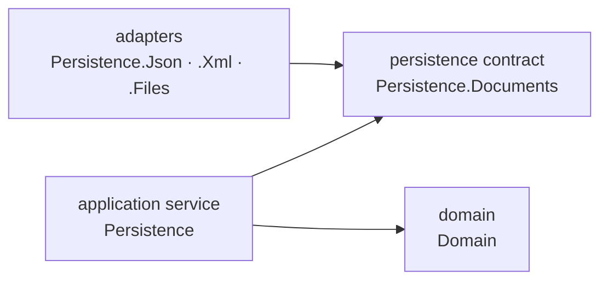

# Nodeheim

A pure, platform-agnostic graph engine. A network of **nodes** that **agents** traverse, wrapped by interchangeable frontends and persistence adapters.


## Overview

Nodeheim is an **engine**, not an application. Its heart is a clean domain core: a graph of nodes, where each node holds references to its neighbors, traversed by agents that move across it. The project follows hexagonal architecture / ports & adapters.

Because the core is domain-agnostic, a logistics simulation, a game world, or a story-driven engine are all just applications built on the same foundation. Applications, such as an editor, live in their own repositories.

## Architecture

All dependencies point inward (the dependency rule). The domain core and the persistence contract reference nothing.



Applications add a frontend and a composition root on top and reference the engine projects they need.

`Nodeheim.Issues` is a cross-cutting library of domain-free types that every role may use.

## Project structure

```
Nodeheim/
├── src/
│   ├── Nodeheim.Domain/                 # domain: pure core, references nothing
│   ├── Nodeheim.Issues/                 # cross-cutting: issues reported by any stage
│   ├── Nodeheim.Persistence.Documents/  # persistence contract: document tree, ports
│   ├── Nodeheim.Persistence/            # application service: loading and saving documents
│   ├── Nodeheim.Persistence.Files/      # adapter: file storage
│   ├── Nodeheim.Persistence.Json/       # adapter: JSON syntax
│   └── Nodeheim.Persistence.Xml/        # adapter: XML syntax
└── tests/
    └── Nodeheim.Domain.Tests/
```

## Getting started

Prerequisites: the [.NET 10 SDK](https://dotnet.microsoft.com/download).

```bash
# clone
git clone https://github.com/tiancama/Nodeheim.git
cd Nodeheim

# build the solution
dotnet build

# run the tests
dotnet test
```

## Tech stack

- **Language / runtime:** C# 14 on .NET 10 (LTS)
- **Tests:** xUnit v3
- **Persistence:** JSON and XML documents; database support planned (SQLite, PostgreSQL)

## Status

Early development. The domain core (nodes, neighbors, and the `Graph` manager) exists. Documents can be loaded and saved as JSON and XML; applications can store their own data in documents alongside the graph. The API is expected to change.

This is primarily a personal learning project; issues and feedback are welcome.

## How this project is built

Nodeheim is developed through AI pair programming. AI is a tool here, not the author: I set the direction, make the design decisions, and review every change that goes into the code, whether I typed it or an assistant suggested it.

## License

Nodeheim is released under the MIT License. See [`LICENSE`](LICENSE) for details.