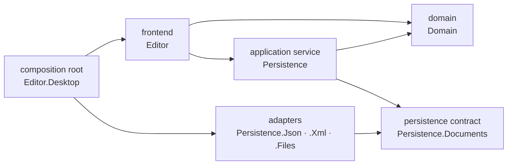

# Nodeheim

A pure, platform-agnostic graph engine. A network of **nodes** that **agents** traverse, wrapped by interchangeable frontends and persistence adapters.


## Overview

Nodeheim is an **engine**, not an application. Its heart is a clean domain core: a graph of nodes, where each node holds references to its neighbors, traversed by agents that move across it. The project follows hexagonal architecture / ports & adapters.

Because the core is domain-agnostic, a logistics simulation, a game world, or a story-driven engine are all just applications built on the same foundation.

## Architecture

All dependencies point inward (the dependency rule). The domain core references nothing; every other project depends on it, never the reverse.



`Nodeheim.Issues` is a cross-cutting library of domain-free types that every role may use.

## Project structure

```
Nodeheim/
└── src/
    ├── Nodeheim.Domain/                 # domain: pure core, references nothing
    ├── Nodeheim.Issues/                 # cross-cutting: issues reported by any stage
    ├── Nodeheim.Persistence.Documents/  # persistence contract: document tree, ports
    ├── Nodeheim.Persistence/            # application service: loading, mapping to the graph
    ├── Nodeheim.Persistence.Files/      # adapter: file storage
    ├── Nodeheim.Persistence.Json/       # adapter: JSON syntax
    ├── Nodeheim.Persistence.Xml/        # adapter: XML syntax
    ├── Nodeheim.Editor/                 # frontend: framework-free view models
    └── Nodeheim.Editor.Desktop/         # composition root and Avalonia views
```

## Getting started

Prerequisites: the [.NET 10 SDK](https://dotnet.microsoft.com/download).

```bash
# clone
git clone https://github.com/tiancama/Nodeheim.git
cd Nodeheim

# build the solution
dotnet build

# run the editor
dotnet run --project src/Nodeheim.Editor.Desktop

# run the tests
dotnet test
```

## Using the editor

| Action | Input |
|---|---|
| Create a node | Double-click on the canvas |
| Select a node or connection | Click |
| Add to or remove from selection | Ctrl+Click |
| Clear selection | Click on empty canvas |
| Move selection | Drag |
| Connect selected nodes | `C` |
| Disconnect selected nodes | `D` |
| Delete selected nodes | `Delete` |

Clicking a connection selects both of its endpoints; dragging it moves both.

## Tech stack

- **Language / runtime:** C# 14 on .NET 10 (LTS)
- **UI:** Avalonia (MVVM), cross-platform
- **Tests:** xUnit v3
- **Persistence:** JSON and XML documents; database support planned (SQLite, PostgreSQL)

## Status

Early development. The domain core (nodes, neighbors, and the `Graph` manager) and an Avalonia editor exist. The editor supports creating, selecting, moving, connecting, disconnecting, and deleting nodes.

**Next milestone, in progress:** loading and saving documents as JSON and XML. Agent movement follows. The API is expected to change.

This is primarily a personal learning project; issues and feedback are welcome.

## How this project is built

Nodeheim is developed through AI pair programming. AI is a tool here, not the author: I set the direction, make the design decisions, and review every change that goes into the code, whether I typed it or an assistant suggested it.

## License

Nodeheim is released under the MIT License. See [`LICENSE`](LICENSE) for details.
